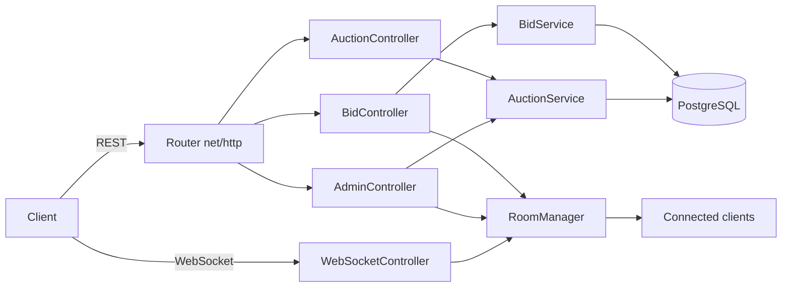
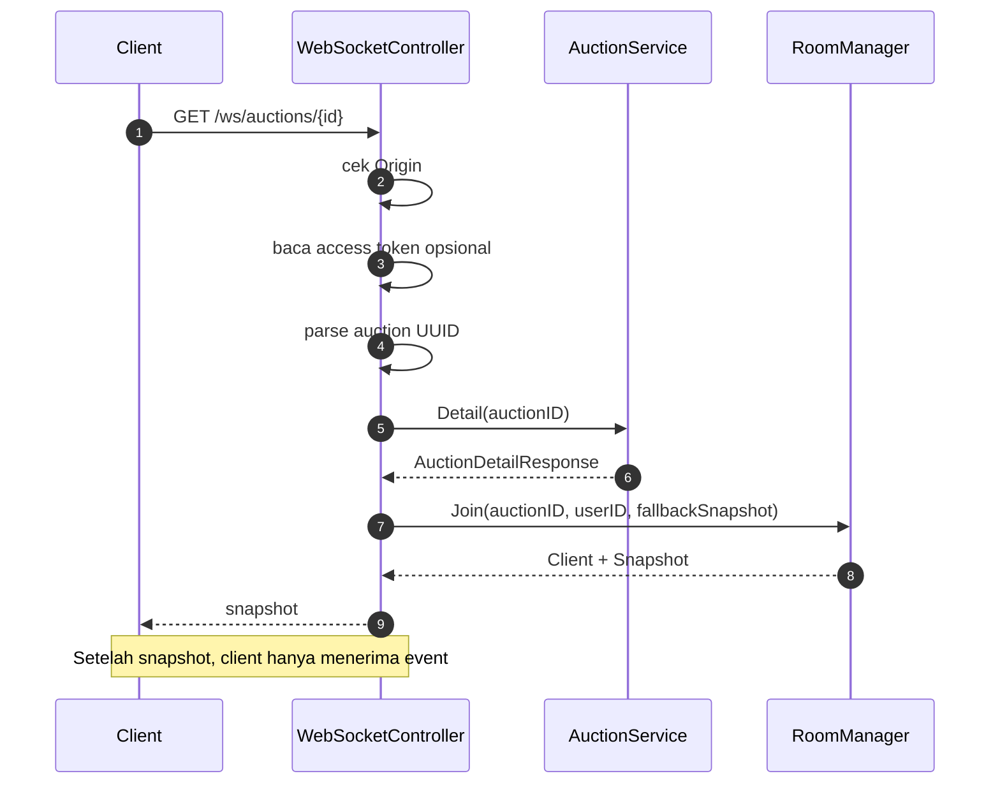
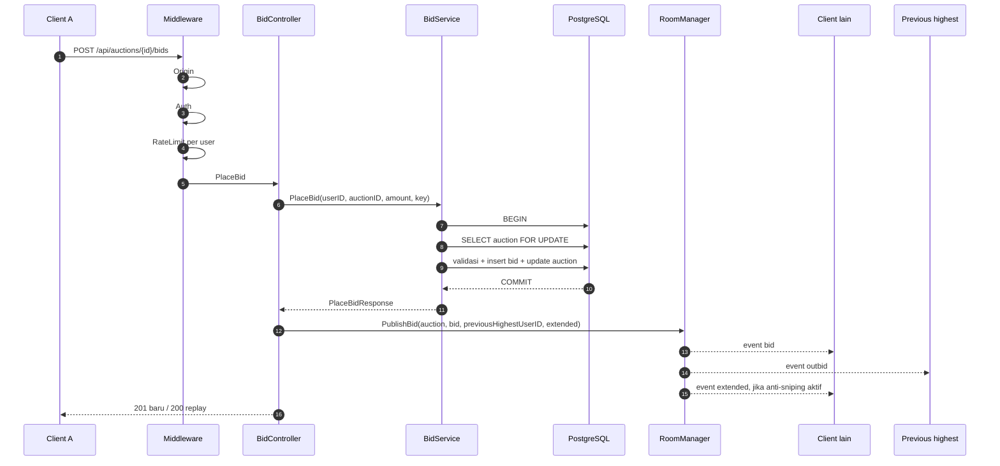
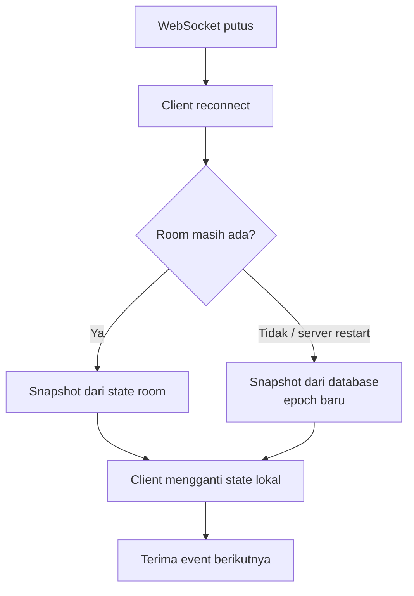
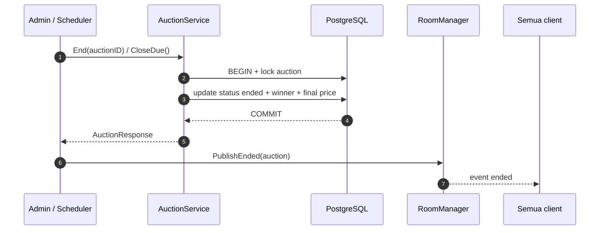

# Task 10: Realtime Room Manager dan WebSocket

Status: panduan implementasi manual.

Task 10 menambahkan:

- room per auction
- snapshot saat client connect
- event bid, outbid, extended, presence, ended
- sequence dan version
- reconnect
- broadcast setelah commit

Task 10 tidak mengubah validasi bid. Sumber kebenaran tetap database.

---

# BAGIAN 1: FLOW

## 0. Arsitektur



REST dan WebSocket memakai state yang sama:

- REST menulis ke PostgreSQL.
- WebSocket hanya mengirim snapshot dan event.
- RoomManager tidak menyimpan sumber kebenaran.
- PostgreSQL tetap sumber kebenaran.

## 1. Client connect



Snapshot berisi:

```json
{
  "type": "snapshot",
  "epoch": "uuid-room",
  "seq": 42,
  "version": 17,
  "server_time": "2026-10-22T10:00:00Z",
  "auction": { "...": "..." },
  "bids": [],
  "viewer_count": 3
}
```

Client memakai snapshot sebagai sumber awal. Setelah itu client hanya menerima event.

## 2. Client bid lewat REST, event lewat WebSocket

Bid tidak dikirim lewat WebSocket. Bid tetap lewat REST:



Urutan ini penting:

```text
commit database
  -> baru broadcast
```

Jangan broadcast sebelum commit. Kalau transaksi rollback, client tidak boleh menerima bid yang tidak pernah tersimpan.

## 3. Event yang diterima client

Bid baru:

```json
{
  "type": "bid",
  "auction_id": "uuid-auction",
  "epoch": "uuid-room",
  "seq": 43,
  "version": 18,
  "server_time": "2026-10-22T10:00:05Z",
  "payload": {
    "auction": { "...": "..." },
    "bid": { "...": "..." },
    "extended": false
  }
}
```

Penawar sebelumnya:

```json
{
  "type": "outbid",
  "payload": {
    "auction": { "...": "..." },
    "bid": { "...": "..." }
  }
}
```

Anti-sniping:

```json
{
  "type": "extended",
  "payload": {
    "ends_at": "2026-10-22T10:11:00Z",
    "extension_count": 1
  }
}
```

Lelang selesai:

```json
{
  "type": "ended",
  "payload": {
    "auction": { "...": "..." }
  }
}
```

Presence:

```json
{
  "type": "presence",
  "payload": {
    "viewer_count": 12
  }
}
```

## 4. Reconnect



Tidak ada replay event lama. Client selalu memulai ulang dari snapshot.

## 5. Admin end dan scheduler



## 6. Sequence, version, dan epoch

```text
epoch   = identitas satu room. Berubah saat room dibuat ulang.
seq     = urutan event di room. Naik satu setiap event.
version = auctions.version. Naik saat state lelang berubah.
```

Aturan:

- client menyimpan `seq` terakhir;
- room mengabaikan event dengan `version` lebih kecil atau sama dengan versi terakhir;
- reconnect selalu memakai snapshot;
- event lama tidak diputar ulang.

## 7. Analogi WebSocket

WebSocket itu seperti **telepon yang tetap tersambung**. HTTP seperti **kurir yang datang setiap kali kita butuh sesuatu**.

### 7.1 Analogi grup lelang

Bayangkan setiap lelang punya satu grup WhatsApp.

```text
Grup Lelang 123
  - penonton A
  - penonton B
  - penonton C
```

Server adalah admin grup.

#### Client masuk

Browser membuka:

```text
GET /ws/auctions/123
```

Itu seperti user menekan tombol **Join grup Lelang 123**.

Server:

1. memeriksa apakah user boleh masuk;
2. menyimpan koneksi user ke daftar grup;
3. mengirim snapshot kondisi terakhir.

Snapshot:

```text
"Lelang 123 sekarang Rp1.500.000, penawar tertinggi Raihan,
sisa waktu 3 menit, ini 50 bid terbaru."
```

Setelah itu koneksi tetap terbuka.

#### Server menyimpan daftar koneksi

Di dalam server kira-kira seperti ini:

```text
room[123] = [koneksi A, koneksi B, koneksi C]
```

Setiap koneksi adalah socket yang masih hidup.

#### Ada bid baru

Bid tetap lewat REST:

```text
POST /api/auctions/123/bids
```

Itu seperti user mengirim formulir resmi ke panitia.

Server menyimpan bid ke database. Setelah commit, server mengumumkan ke grup:

```text
"Bid baru: Rp1.600.000 dari Dewi"
```

Server tidak membuat koneksi baru. Server hanya menulis ke socket yang sudah terbuka:

```text
for setiap client di room[123]:
    kirim event bid
```

Itulah broadcast.

#### Outbid

Kalau Raihan adalah penawar sebelumnya, Raihan mendapat pesan khusus:

```text
"Kamu sudah outbid. Harga sekarang Rp1.600.000."
```

Jadi:

- `bid` dikirim ke semua orang di room;
- `outbid` hanya ke penawar sebelumnya;
- `extended` dikirim ke semua orang jika anti-sniping aktif.

#### Client keluar

Kalau browser ditutup atau koneksi putus:

```text
room[123] menghapus koneksi A
```

Server berhenti mengirim ke socket itu.

#### Client reconnect

Client masuk lagi:

```text
GET /ws/auctions/123
```

Server tidak memutar ulang semua event lama. Server mengirim snapshot terbaru:

```text
"Kondisi sekarang: Rp1.700.000, penawar tertinggi Dewi,
sisa waktu 2 menit, ini bid terbaru."
```

Itu sebabnya WebSocket tidak perlu menyimpan seluruh riwayat event.

### 7.2 HTTP vs WebSocket

HTTP:

```text
Client: "Ada bid baru?"
Server: "Ada."
Koneksi selesai.

Client: "Sekarang ada bid baru?"
Server: "Ada."
Koneksi selesai.
```

Itu polling. Boros dan lambat.

WebSocket:

```text
Client: "Saya masuk room 123."
Server: "Oke, koneksi dibuka."

... koneksi tetap hidup ...

Server: "Bid baru."
Server: "Bid baru lagi."
Server: "Lelang diperpanjang."
Server: "Lelang selesai."
```

Client tidak perlu bertanya berulang kali. Server yang mendorong event.

### 7.3 Analogi komponen

```text
WebSocket       = kabel telepon yang tidak ditutup
RoomManager     = daftar siapa saja yang sedang ada di telepon grup
Snapshot        = rekaman kondisi terakhir saat baru masuk
BidService      = panitia yang mencatat bid ke buku besar
Database        = buku besar
Broadcast       = panitia berbicara ke semua telepon di grup
Outbid          = panitia menelepon satu orang secara pribadi
Reconnect       = masuk lagi dan minta rekaman kondisi terbaru
```

### 7.4 Kenapa WebSocket bukan NATS

NATS itu seperti **kantor pos antar cabang perusahaan**.

- WebSocket adalah kabel dari server ke browser.
- NATS adalah sistem pengiriman pesan antar server.

Kalau hanya satu server, WebSocket + `RoomManager` sudah cukup.

Kalau nanti ada tiga server:

```text
Server A punya client A
Server B punya client B
Server C punya client C
```

Bid masuk ke Server A. Server B dan C tidak tahu. Di situ NATS atau Redis pub/sub dipakai untuk memberi tahu ketiga server, lalu masing-masing server meneruskan ke client WebSocket miliknya.

Untuk proyek ini:

```text
Browser <--WebSocket--> Server
                           |
                           +-- RoomManager
                           |
                           +-- PostgreSQL
```

`RoomManager` tidak menyimpan data lelang. Dia hanya memegang daftar koneksi dan mengirim event ke koneksi yang sudah terbuka.

---

# BAGIAN 2: IMPLEMENTASI

## 1. Dependency

```powershell
cd D:\live-auction\server
go get github.com/coder/websocket@latest
```

## 2. File

```text
server/internal/realtime/
  event.go
  client.go
  room.go
  manager.go
  manager_test.go

server/internal/controller/
  websocket_controller.go
  websocket_controller_test.go
```

## 3. Event dan snapshot

Buat `internal/realtime/event.go`:

```go
package realtime

import (
	"time"

	"github.com/google/uuid"

	"live-auction/server/internal/model/web/auction_response"
)

type Snapshot struct {
	Type        string                         `json:"type"`
	Epoch       string                         `json:"epoch"`
	Seq         int64                          `json:"seq"`
	Version     int64                          `json:"version"`
	ServerTime  time.Time                      `json:"server_time"`
	Auction     auction_response.AuctionResponse `json:"auction"`
	Bids        []auction_response.BidResponse   `json:"bids"`
	ViewerCount int                            `json:"viewer_count"`
}

type Event struct {
	Type       string    `json:"type"`
	AuctionID  uuid.UUID `json:"auction_id"`
	Epoch      string    `json:"epoch"`
	Seq        int64     `json:"seq"`
	Version    int64     `json:"version"`
	ServerTime time.Time `json:"server_time"`
	Payload    any       `json:"payload"`
}
```

## 4. Client

Buat `internal/realtime/client.go`:

```go
package realtime

import "github.com/google/uuid"

type Client struct {
	UserID *uuid.UUID
	Send   chan []byte
}
```

## 5. Room

Buat `internal/realtime/room.go`:

```go
package realtime

import (
	"encoding/json"
	"sync"
	"time"

	"github.com/google/uuid"

	"live-auction/server/internal/model/web/auction_response"
)

type Room struct {
	mu          sync.Mutex
	clients     map[*Client]struct{}
	epoch       string
	seq         int64
	version     int64
	auction     auction_response.AuctionResponse
	bids        []auction_response.BidResponse
	lastPresence time.Time
}

func newRoom(epoch string, fallback Snapshot) *Room {
	return &Room{
		clients: make(map[*Client]struct{}),
		epoch:   epoch,
		seq:     fallback.Seq,
		version: fallback.Version,
		auction: fallback.Auction,
		bids:    fallback.Bids,
	}
}

func (r *Room) nextEvent(eventType string, auctionID uuid.UUID, payload any) []byte {
	r.seq++

	event := Event{
		Type:       eventType,
		AuctionID:  auctionID,
		Epoch:      r.epoch,
		Seq:        r.seq,
		Version:    r.version,
		ServerTime: time.Now().UTC(),
		Payload:    payload,
	}

	data, _ := json.Marshal(event)
	return data
}

func (r *Room) broadcast(data []byte) {
	for client := range r.clients {
		r.send(client, data)
	}
}

func (r *Room) send(client *Client, data []byte) {
	select {
	case client.Send <- data:
	default:
		delete(r.clients, client)
		close(client.Send)
	}
}
```

## 6. Room manager

Buat `internal/realtime/manager.go`:

```go
package realtime

import (
	"sync"
	"time"

	"github.com/google/uuid"

	"live-auction/server/internal/model/web/auction_response"
)

type RoomManager struct {
	mu    sync.Mutex
	rooms map[uuid.UUID]*Room
	now   func() time.Time
}

func NewRoomManager() *RoomManager {
	return &RoomManager{
		rooms: make(map[uuid.UUID]*Room),
		now:   time.Now,
	}
}

func (m *RoomManager) Join(
	auctionID uuid.UUID,
	userID *uuid.UUID,
	fallback Snapshot,
) (*Client, Snapshot) {
	m.mu.Lock()
	room := m.rooms[auctionID]
	if room == nil {
		room = newRoom(uuid.NewString(), fallback)
		m.rooms[auctionID] = room
	}
	m.mu.Unlock()

	room.mu.Lock()
	defer room.mu.Unlock()

	client := &Client{
		UserID: userID,
		Send:   make(chan []byte, 32),
	}
	room.clients[client] = struct{}{}

	snapshot := Snapshot{
		Type:        "snapshot",
		Epoch:       room.epoch,
		Seq:         room.seq,
		Version:     room.version,
		ServerTime:  m.now().UTC(),
		Auction:     room.auction,
		Bids:        room.bids,
		ViewerCount: len(room.clients),
	}

	m.publishPresenceLocked(room, auctionID)

	return client, snapshot
}

func (m *RoomManager) Leave(auctionID uuid.UUID, client *Client) {
	m.mu.Lock()
	room := m.rooms[auctionID]
	m.mu.Unlock()
	if room == nil {
		return
	}

	room.mu.Lock()
	defer room.mu.Unlock()

	if _, ok := room.clients[client]; !ok {
		return
	}

	delete(room.clients, client)
	close(client.Send)

	m.publishPresenceLocked(room, auctionID)
}
```

```go
func (m *RoomManager) PublishBid(
	auction auction_response.AuctionResponse,
	bid auction_response.BidResponse,
	previousHighestUserID *uuid.UUID,
	extended bool,
) {
	m.mu.Lock()
	room := m.rooms[auction.ID]
	m.mu.Unlock()
	if room == nil {
		return
	}

	room.mu.Lock()
	defer room.mu.Unlock()

	if auction.Version <= room.version {
		return
	}

	room.version = auction.Version
	room.auction = auction
	room.bids = append([]auction_response.BidResponse{bid}, room.bids...)
	if len(room.bids) > 50 {
		room.bids = room.bids[:50]
	}

	bidEvent := room.nextEvent("bid", auction.ID, map[string]any{
		"auction":  auction,
		"bid":      bid,
		"extended": extended,
	})
	room.broadcast(bidEvent)

	if previousHighestUserID != nil {
		outbidEvent := room.nextEvent("outbid", auction.ID, map[string]any{
			"auction": auction,
			"bid":     bid,
		})
		for client := range room.clients {
			if client.UserID != nil && *client.UserID == *previousHighestUserID {
				room.send(client, outbidEvent)
			}
		}
	}

	if extended {
		extendedEvent := room.nextEvent("extended", auction.ID, map[string]any{
			"ends_at":         auction.EndsAt,
			"extension_count": auction.ExtensionCount,
		})
		room.broadcast(extendedEvent)
	}
}
```

`PublishEnded`:

```go
func (m *RoomManager) PublishEnded(auction auction_response.AuctionResponse) {
	m.mu.Lock()
	room := m.rooms[auction.ID]
	m.mu.Unlock()
	if room == nil {
		return
	}

	room.mu.Lock()
	defer room.mu.Unlock()

	room.version = auction.Version
	room.auction = auction

	event := room.nextEvent("ended", auction.ID, map[string]any{
		"auction": auction,
	})
	room.broadcast(event)
}
```

Presence:

```go
func (m *RoomManager) publishPresenceLocked(room *Room, auctionID uuid.UUID) {
	if time.Since(room.lastPresence) < time.Second {
		return
	}
	room.lastPresence = time.Now()

	event := room.nextEvent("presence", auctionID, map[string]any{
		"viewer_count": len(room.clients),
	})
	room.broadcast(event)
}
```

## 7. WebSocket controller

Buat `internal/controller/websocket_controller.go`:

```go
package controller

import (
	"context"
	"encoding/json"
	"net/http"
	"net/url"
	"time"

	"github.com/coder/websocket"
	"github.com/google/uuid"

	"live-auction/server/internal/auth"
	"live-auction/server/internal/realtime"
	"live-auction/server/internal/service"
)

type WebSocketController struct {
	rooms         *realtime.RoomManager
	auctions      service.AuctionService
	tokens        *auth.AccessTokens
	allowedOrigin string
}

func NewWebSocketController(
	rooms *realtime.RoomManager,
	auctions service.AuctionService,
	tokens *auth.AccessTokens,
	allowedOrigin string,
) *WebSocketController {
	return &WebSocketController{
		rooms:         rooms,
		auctions:      auctions,
		tokens:        tokens,
		allowedOrigin: allowedOrigin,
	}
}

func (c *WebSocketController) ServeWS(w http.ResponseWriter, r *http.Request) {
	auctionID, err := uuid.Parse(r.PathValue("id"))
	if err != nil {
		http.Error(w, "invalid auction id", http.StatusUnprocessableEntity)
		return
	}

	userID := c.optionalUserID(r)

	detail, err := c.auctions.Detail(r.Context(), auctionID)
	if err != nil {
		http.Error(w, "auction not found", http.StatusNotFound)
		return
	}

	originPatterns := []string{}
	if u, err := url.Parse(c.allowedOrigin); err == nil && u.Host != "" {
		originPatterns = append(originPatterns, u.Host)
	}

	conn, err := websocket.Accept(w, r, &websocket.AcceptOptions{
		OriginPatterns: originPatterns,
	})
	if err != nil {
		return
	}
	defer conn.Close(websocket.StatusNormalClosure, "closed")

	fallback := realtime.Snapshot{
		Type:       "snapshot",
		Version:    detail.Auction.Version,
		ServerTime: detail.ServerTime,
		Auction:    detail.Auction,
		Bids:       detail.Bids,
	}

	client, snapshot := c.rooms.Join(auctionID, userID, fallback)
	defer c.rooms.Leave(auctionID, client)

	if err := writeJSON(r.Context(), conn, snapshot); err != nil {
		return
	}

	ctx, cancel := context.WithCancel(r.Context())
	defer cancel()

	go c.writeLoop(ctx, conn, client)
	go c.pingLoop(ctx, conn)

	for {
		if _, _, err := conn.Read(ctx); err != nil {
			return
		}
	}
}

func (c *WebSocketController) optionalUserID(r *http.Request) *uuid.UUID {
	cookie, err := r.Cookie(auth.AccessCookieName)
	if err != nil {
		return nil
	}

	principal, err := c.tokens.Parse(cookie.Value)
	if err != nil {
		return nil
	}

	return &principal.UserID
}

func (c *WebSocketController) writeLoop(ctx context.Context, conn *websocket.Conn, client *realtime.Client) {
	for {
		select {
		case <-ctx.Done():
			return
		case data, ok := <-client.Send:
			if !ok {
				return
			}

			writeCtx, cancel := context.WithTimeout(ctx, 5*time.Second)
			err := conn.Write(writeCtx, websocket.MessageText, data)
			cancel()
			if err != nil {
				return
			}
		}
	}
}

func (c *WebSocketController) pingLoop(ctx context.Context, conn *websocket.Conn) {
	ticker := time.NewTicker(20 * time.Second)
	defer ticker.Stop()

	for {
		select {
		case <-ctx.Done():
			return
		case <-ticker.C:
			pingCtx, cancel := context.WithTimeout(ctx, 10*time.Second)
			err := conn.Ping(pingCtx)
			cancel()
			if err != nil {
				return
			}
		}
	}
}

func writeJSON(ctx context.Context, conn *websocket.Conn, payload any) error {
	data, err := json.Marshal(payload)
	if err != nil {
		return err
	}

	writeCtx, cancel := context.WithTimeout(ctx, 5*time.Second)
	defer cancel()

	return conn.Write(writeCtx, websocket.MessageText, data)
}
```

Tambahkan import `encoding/json`.

## 8. Hubungkan BidController

Tambahkan `rooms *realtime.RoomManager` ke `BidController` dan konstruktornya.

Setelah `PlaceBid` sukses:

```go
c.rooms.PublishBid(
	result.Auction,
	result.Bid,
	result.PreviousHighestUserID,
	result.Extended,
)
```

Publish dilakukan setelah service commit. Jangan di dalam service atau transaksi.

## 9. Hubungkan AdminController

Tambahkan `rooms *realtime.RoomManager` ke `AdminController`.

Setelah `End` sukses:

```go
c.rooms.PublishEnded(result)
```

## 10. Router dan main

Tambahkan ke `RouterDeps`:

```go
WebSocket *controller.WebSocketController
```

Daftarkan:

```go
if deps.WebSocket != nil {
	mux.HandleFunc("GET /ws/auctions/{id}", deps.WebSocket.ServeWS)
}
```

Di `main.go`:

```go
rooms := realtime.NewRoomManager()
wsController := controller.NewWebSocketController(
	rooms,
	auctionService,
	accessTokens,
	cfg.AppOrigin,
)
```

Lalu isi:

```go
WebSocket: wsController,
```

`rooms` tetap dipakai untuk `BidController`, `AdminController`, dan `WebSocketController`.

## 11. Test

Room manager:

- join mengembalikan snapshot
- dua client menerima event yang sama
- event dengan version lama diabaikan
- outbid hanya ke previous highest
- presence count berubah
- leave menutup channel
- ended diterima semua client

WebSocket integration:

- connect client
- terima snapshot
- lakukan bid lewat REST
- dua client menerima event bid
- previous bidder menerima outbid
- reconnect menerima snapshot baru
- client tidak mengirim command lewat socket

Verifikasi:

```powershell
go test ./internal/realtime ./internal/controller
go test ./...
go build ./...
go vet ./...
```

## Checklist

- [ ] dependency `coder/websocket`
- [ ] `Event`, `Snapshot`, `Client` dibuat
- [ ] `Room` dibuat
- [ ] `RoomManager` dibuat
- [ ] `Join` mengirim snapshot
- [ ] `PublishBid` mengirim bid, outbid, extended
- [ ] `PublishEnded` mengirim ended
- [ ] presence debounce
- [ ] `WebSocketController` dibuat
- [ ] optional auth cookie
- [ ] origin check
- [ ] heartbeat
- [ ] `BidController` publish setelah commit
- [ ] `AdminController` publish ended
- [ ] router route `/ws/auctions/{id}`
- [ ] main wiring
- [ ] test room manager dan WebSocket
- [ ] `go test ./...` lulus
- [ ] `go build ./...` lulus
- [ ] `go vet ./...` lulus
