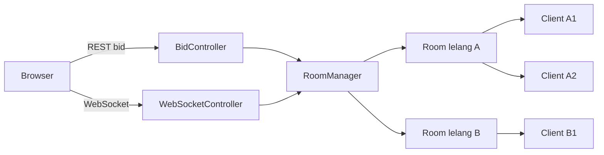
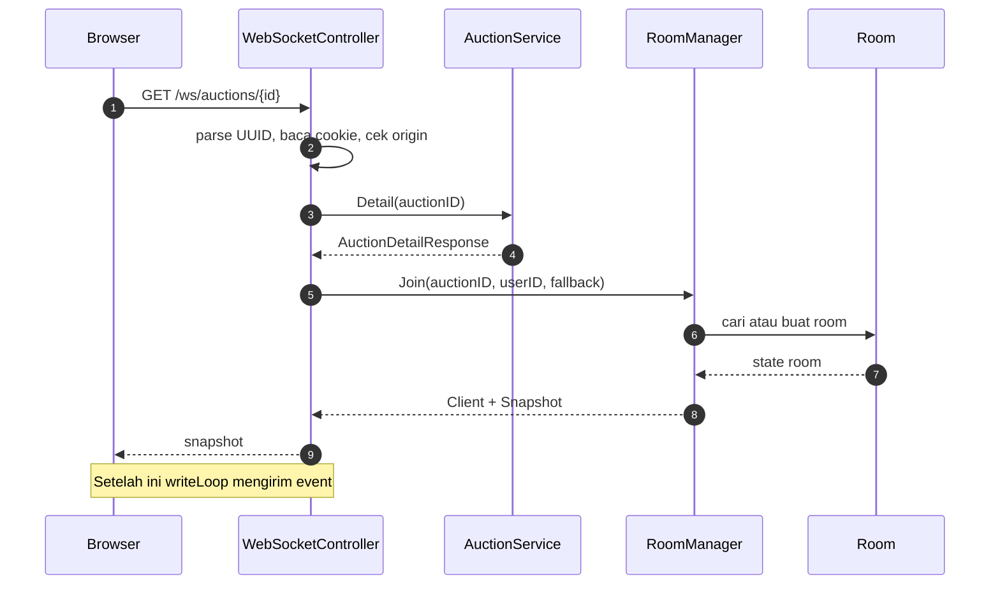
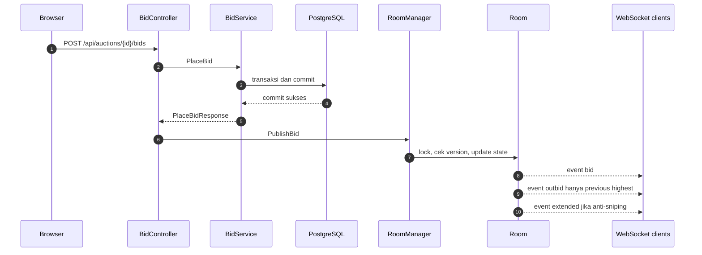
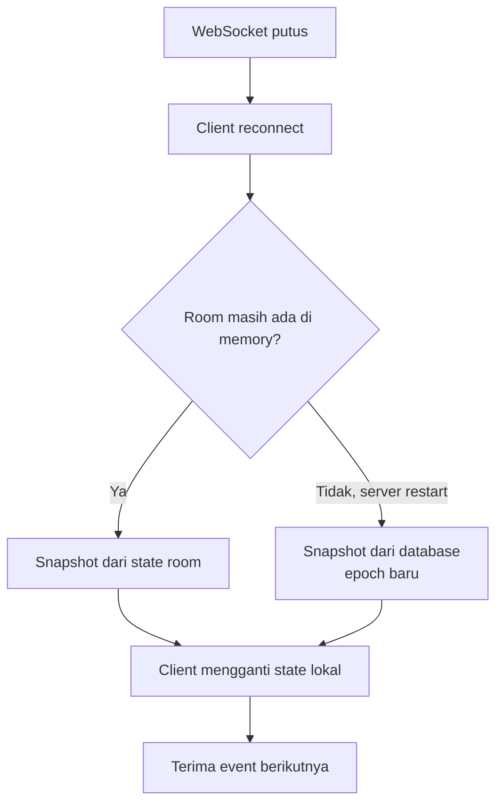

# Task 10: WebSocket Code Walkthrough

Dokumen ini menjelaskan cara kerja:

- `server/internal/realtime/room.go`
- `server/internal/realtime/manager.go`
- `server/internal/controller/websocket_controller.go`

Tujuannya bukan menghafal kode, tetapi memahami:

1. siapa yang menyimpan state;
2. siapa yang mengunci data;
3. bagaimana event sampai ke browser;
4. kapan client menerima snapshot;
5. mengapa bid tetap lewat REST.

---

## 1. Mental model

Anggap sistem realtime ini seperti gedung lelang.

```text
RoomManager = gedung
Room        = satu ruangan lelang
Client      = orang yang masuk ruangan
Send        = kotak surat per orang
writeLoop   = kurir yang mengirim isi kotak ke socket browser
```

Diagram arsitekturnya:



Yang penting:

- REST menulis bid ke PostgreSQL.
- WebSocket mengirim snapshot dan event ke browser.
- `RoomManager` bukan sumber kebenaran.
- PostgreSQL tetap sumber kebenaran.
- `RoomManager` hanya menyimpan state sementara di memory.

---

## 2. Tipe pendukung

### `Client`

```go
type Client struct {
	UserID *uuid.UUID
	Send   chan []byte
}
```

`Client` adalah satu koneksi WebSocket.

| Field | Arti |
|---|---|
| `UserID` | ID user yang login. `nil` berarti penonton tamu |
| `Send` | Antrian event yang akan ditulis ke socket |

`UserID` memakai pointer supaya bisa membedakan:

```text
nil          -> tamu
uuid.Nil     -> user dengan UUID kosong, seharusnya tidak terjadi
uuid valid   -> user login
```

`Send` adalah channel buffered. Di `Join`, channel dibuat dengan kapasitas 32:

```go
Send: make(chan []byte, 32)
```

Artinya satu client bisa menampung 32 event sebelum dianggap lambat.

### `Snapshot`

```go
type Snapshot struct {
	Type        string
	Epoch       string
	Seq         int64
	Version     int64
	ServerTime  time.Time
	Auction     auction_response.AuctionResponse
	Bids        []auction_response.BidResponse
	ViewerCount int
}
```

Snapshot adalah kondisi awal saat client baru masuk.

Isinya:

- `epoch`: identitas room;
- `seq`: nomor event terakhir sebelum snapshot;
- `version`: versi state lelang;
- `auction`: state lelang;
- `bids`: maksimal 50 bid terbaru;
- `viewer_count`: jumlah penonton saat itu.

### `Event`

```go
type Event struct {
	Type       string
	AuctionID  uuid.UUID
	Epoch      string
	Seq        int64
	Version    int64
	ServerTime time.Time
	Payload    any
}
```

`Event` adalah pesan setelah snapshot.

Jenis event:

- `bid`
- `outbid`
- `extended`
- `presence`
- `ended`

`Payload` memakai `any` karena bentuk payload berbeda-beda.

---

## 3. `room.go`

File ini mengurus satu lelang.

### 3.1 Struct `Room`

```go
type Room struct {
	mu           sync.Mutex
	clients      map[*Client]struct{}
	epoch        string
	seq          int64
	version      int64
	auction      auction_response.AuctionResponse
	bids         []auction_response.BidResponse
	lastPresence time.Time
}
```

| Field | Fungsi |
|---|---|
| `mu` | Mengunci seluruh state room |
| `clients` | Daftar client yang sedang menonton |
| `epoch` | Identitas room |
| `seq` | Nomor urut event |
| `version` | Versi state lelang dari database |
| `auction` | State lelang terakhir |
| `bids` | Maksimal 50 bid terbaru, terbaru di depan |
| `lastPresence` | Waktu terakhir presence dikirim |

`clients` memakai `map[*Client]struct{}` karena:

- key-nya pointer client;
- value kosong tidak memakan memory;
- tambah, hapus, dan cek anggota cepat.

### 3.2 `newRoom`

```go
func newRoom(epoch string, fallback Snapshot) *Room
```

Dipakai saat room pertama kali dibuat.

Yang dilakukan:

1. membuat map client kosong;
2. menyimpan `epoch`;
3. mengisi `seq`, `version`, `auction`, dan `bids` dari `fallback`;
4. mengembalikan pointer room.

`fallback` berasal dari `AuctionService.Detail`.

Jadi saat client pertama masuk, room belum punya state sendiri. State awalnya diambil dari database.

### 3.3 `nextEvent`

```go
func (r *Room) nextEvent(eventType string, auctionID uuid.UUID, payload any) []byte
```

Fungsi ini membuat event baru.

Langkahnya:

1. `r.seq++`;
2. membuat struct `Event`;
3. mengisi tipe, auction ID, epoch, seq, version, dan waktu server;
4. mengubah event menjadi JSON;
5. mengembalikan `[]byte`.

JSON di-encode satu kali, lalu byte yang sama dikirim ke semua client.

Catatan penting:

```go
func (r *Room) nextEvent(...)
```

Fungsi ini tidak mengunci mutex sendiri. Pemanggil harus sudah memegang `r.mu`.

### 3.4 `broadcast`

```go
func (r *Room) broadcast(data []byte)
```

Mengirim event ke semua client:

```go
for client := range r.clients {
	r.send(client, data)
}
```

Fungsi ini juga tidak mengunci mutex sendiri. Pemanggil harus memegang `r.mu`.

### 3.5 `send`

```go
func (r *Room) send(client *Client, data []byte)
```

Ini adalah mekanisme backpressure.

```go
select {
case client.Send <- data:
default:
	delete(r.clients, client)
	close(client.Send)
}
```

Artinya:

- kalau channel masih punya ruang, event dimasukkan;
- kalau channel penuh, client dianggap lambat;
- client dihapus dari room;
- channel ditutup.

Kenapa tidak menunggu?

Kalau server menunggu satu client yang lambat, semua client lain ikut tertahan. Dengan `default`, server tidak diblokir oleh satu koneksi lambat.

Setelah channel ditutup, `writeLoop` akan berhenti.

---

## 4. `manager.go`

File ini mengelola banyak room.

### 4.1 Struct `RoomManager`

```go
type RoomManager struct {
	mu    sync.Mutex
	rooms map[uuid.UUID]*Room
	now   func() time.Time
}
```

| Field | Fungsi |
|---|---|
| `mu` | Mengunci map `rooms` |
| `rooms` | Semua room, key-nya auction ID |
| `now` | Fungsi waktu, bisa diganti saat test |

Ada dua mutex berbeda:

```text
RoomManager.mu  -> melindungi map rooms
Room.mu         -> melindungi isi satu room
```

### 4.2 `NewRoomManager`

Membuat manager dengan map kosong dan `now = time.Now`.

Satu instance `RoomManager` dipakai bersama oleh:

- `WebSocketController`;
- `BidController`;
- `AdminController`.

Itu sebabnya bid dari REST bisa masuk ke room yang sama dengan client WebSocket.

### 4.3 `Join`

```go
func (m *RoomManager) Join(
	auctionID uuid.UUID,
	userID *uuid.UUID,
	fallback Snapshot,
) (*Client, Snapshot)
```

Dipanggil saat client WebSocket berhasil connect.

#### Langkah 1: cari atau buat room

```go
m.mu.Lock()
room := m.rooms[auctionID]
if room == nil {
	room = newRoom(uuid.NewString(), fallback)
	m.rooms[auctionID] = room
}
m.mu.Unlock()
```

Kalau room belum ada:

- buat room baru;
- beri `epoch` baru;
- isi state dari `fallback`;
- simpan ke map.

Kalau room sudah ada:

- `fallback` diabaikan;
- state room yang sudah ada dipertahankan.

Kenapa fallback diabaikan?

Karena room yang sudah ada mungkin sudah menerima bid yang lebih baru daripada snapshot database yang baru dibaca.

#### Langkah 2: kunci room

```go
room.mu.Lock()
defer room.mu.Unlock()
```

Setelah ini, tidak ada client lain yang bisa mengubah isi room secara bersamaan.

#### Langkah 3: buat client

```go
client := &Client{
	UserID: userID,
	Send:   make(chan []byte, 32),
}
room.clients[client] = struct{}{}
```

`UserID` boleh `nil`. Itu artinya penonton tamu.

#### Langkah 4: buat snapshot

```go
snapshot := Snapshot{
	Type:        "snapshot",
	Epoch:       room.epoch,
	Seq:         room.seq,
	Version:     room.version,
	ServerTime:  m.now().UTC(),
	Auction:     room.auction,
	Bids:        room.bids,
	ViewerCount: len(room.clients),
}
```

`ViewerCount` sudah termasuk client yang baru join.

#### Langkah 5: kirim presence

```go
m.publishPresenceLocked(room, auctionID)
```

Ini memberi tahu client lain bahwa jumlah penonton berubah.

Nama `publishPresenceLocked` berarti fungsi ini berasumsi `room.mu` sudah dikunci.

#### Langkah 6: return

Mengembalikan `client` dan `snapshot`.

Controller nanti mengirim snapshot ke socket, lalu memulai writer loop.

### 4.4 `Leave`

```go
func (m *RoomManager) Leave(auctionID uuid.UUID, client *Client)
```

Dipanggil saat client disconnect.

Langkahnya:

1. cari room;
2. kalau room tidak ada, return;
3. kunci room;
4. cek apakah client masih ada;
5. hapus dari map;
6. tutup channel `client.Send`;
7. kirim presence terbaru.

Pengecekan ini penting:

```go
if _, ok := room.clients[client]; !ok {
	return
}
```

Kalau `Leave` dipanggil dua kali, panggilan kedua tidak menutup channel dua kali. Menutup channel yang sudah ditutup akan panic.

### 4.5 `publishPresenceLocked`

```go
func (m *RoomManager) publishPresenceLocked(room *Room, auctionID uuid.UUID)
```

Mengirim event:

```json
{
  "type": "presence",
  "payload": {
    "viewer_count": 3
  }
}
```

Ada debounce satu detik:

```go
if now.Sub(room.lastPresence) < time.Second {
	return
}
```

Tujuannya agar kalau 20 orang join dalam waktu bersamaan, server tidak mengirim 20 event presence berturut-turut.

Fungsi ini dipanggil oleh `Join` dan `Leave`, selalu saat `room.mu` sudah dipegang.

### 4.6 `PublishBid`

Ini fungsi paling penting.

```go
func (m *RoomManager) PublishBid(
	auction auction_response.AuctionResponse,
	bid auction_response.BidResponse,
	previousHighestUserID *uuid.UUID,
	extended bool,
)
```

Dipanggil setelah bid berhasil disimpan ke database.

#### Langkah 1: cari room

```go
room := m.rooms[auction.ID]
if room == nil {
	return
}
```

Kalau tidak ada yang menonton lelang ini, event tidak perlu dikirim.

Nanti kalau ada yang join, dia akan mendapat snapshot terbaru dari database.

#### Langkah 2: cek versi

```go
if auction.Version <= room.version {
	return
}
```

Ini mencegah event lama atau duplikat dikirim.

Contoh:

- room sudah punya versi 10;
- datang event versi 10;
- event diabaikan.

Ini juga membantu saat HTTP bid di-retry dengan idempotency yang sama. Replay tidak akan mengirim event baru kalau versinya tidak berubah.

#### Langkah 3: update state room

```go
room.version = auction.Version
room.auction = auction
room.bids = append([]auction_response.BidResponse{bid}, room.bids...)
if len(room.bids) > 50 {
	room.bids = room.bids[:50]
}
```

Bid baru ditaruh di depan. Kalau lebih dari 50, yang paling lama dibuang.

#### Langkah 4: kirim event `bid`

```go
bidEvent := room.nextEvent("bid", auction.ID, map[string]any{
	"auction":  auction,
	"bid":      bid,
	"extended": extended,
})
room.broadcast(bidEvent)
```

Semua client menerima event ini.

#### Langkah 5: kirim event `outbid`

```go
if previousHighestUserID != nil {
	outbidEvent := room.nextEvent("outbid", ...)
	for client := range room.clients {
		if client.UserID != nil && *client.UserID == *previousHighestUserID {
			room.send(client, outbidEvent)
		}
	}
}
```

Event ini hanya dikirim ke client yang user ID-nya sama dengan penawar tertinggi sebelumnya.

Kalau penonton tamu, `UserID` adalah `nil`, jadi tidak akan pernah menerima outbid.

Kalau user punya dua tab, kedua tab bisa menerima outbid karena keduanya memiliki user ID yang sama.

#### Langkah 6: kirim event `extended`

```go
if extended {
	extendedEvent := room.nextEvent("extended", ...)
	room.broadcast(extendedEvent)
}
```

Kalau anti-sniping aktif, semua client diberi tahu bahwa waktu lelang berubah.

Urutan event untuk penawar sebelumnya:

```text
bid -> outbid -> extended
```

Urutan untuk client lain:

```text
bid -> extended
```

Setiap event menaikkan `seq`.

### 4.7 `PublishEnded`

```go
func (m *RoomManager) PublishEnded(auction auction_response.AuctionResponse)
```

Dipanggil setelah admin atau scheduler mengakhiri lelang.

Langkahnya:

1. cari room;
2. update `version` dan `auction`;
3. buat event `ended`;
4. broadcast ke semua client.

Fungsi ini tidak menutup koneksi client. Client tetap terhubung walaupun lelang sudah selesai.

---

## 5. `websocket_controller.go`

File ini adalah pintu masuk HTTP yang berubah menjadi WebSocket.

### 5.1 Struct `WebSocketController`

```go
type WebSocketController struct {
	rooms         *realtime.RoomManager
	auctions      service.AuctionService
	tokens        *auth.AccessTokens
	allowedOrigin string
}
```

| Field | Fungsi |
|---|---|
| `rooms` | Manager room yang sama dengan bid/admin |
| `auctions` | Mengambil snapshot awal dari database |
| `tokens` | Membaca access token dari cookie |
| `allowedOrigin` | Origin frontend yang diizinkan |

### 5.2 `ServeWS`

```go
func (c *WebSocketController) ServeWS(w http.ResponseWriter, r *http.Request)
```

Ini handler utama.

#### Langkah 1: parse auction ID

```go
auctionID, err := uuid.Parse(r.PathValue("id"))
if err != nil {
	http.Error(w, "invalid auction id", http.StatusUnprocessableEntity)
	return
}
```

Kalau URL bukan UUID valid, request ditolak dengan HTTP 422 sebelum WebSocket dibuat.

#### Langkah 2: ambil user opsional

```go
userID := c.optionalUserID(r)
```

Client tidak wajib login. Kalau tidak ada cookie atau token tidak valid, `userID` bernilai `nil` dan client menjadi penonton tamu.

#### Langkah 3: ambil detail lelang

```go
detail, err := c.auctions.Detail(r.Context(), auctionID)
if err != nil {
	http.Error(w, "auction not found", http.StatusNotFound)
	return
}
```

Ini mengambil:

- data auction;
- 50 bid terbaru;
- server time.

Data ini menjadi fallback snapshot kalau room belum ada.

#### Langkah 4: bangun origin pattern

```go
originPatterns := []string{}
if u, err := url.Parse(c.allowedOrigin); err == nil && u.Host != "" {
	originPatterns = append(originPatterns, u.Host)
}
```

Contoh:

```text
allowedOrigin = http://localhost:5173
origin pattern = localhost:5173
```

`websocket.Accept` akan menolak handshake dari origin lain.

Kalau `allowedOrigin` kosong, pattern kosong, dan library memakai aturan same-origin.

#### Langkah 5: upgrade HTTP menjadi WebSocket

```go
conn, err := websocket.Accept(w, r, &websocket.AcceptOptions{
	OriginPatterns: originPatterns,
})
```

Setelah berhasil, koneksi HTTP berubah menjadi koneksi WebSocket dua arah.

#### Langkah 6: siapkan fallback snapshot

```go
fallback := realtime.Snapshot{
	Type:       "snapshot",
	Version:    detail.Auction.Version,
	ServerTime: detail.ServerTime,
	Auction:    detail.Auction,
	Bids:       detail.Bids,
}
```

#### Langkah 7: join ke room

```go
client, snapshot := c.rooms.Join(auctionID, userID, fallback)
defer c.rooms.Leave(auctionID, client)
```

Kalau room sudah ada, snapshot yang dikembalikan adalah state room, bukan fallback database.

`defer Leave` memastikan client dihapus saat handler selesai.

#### Langkah 8: kirim snapshot

```go
if err := writeJSON(r.Context(), conn, snapshot); err != nil {
	return
}
```

Ini pesan pertama yang diterima client.

#### Langkah 9: buat context dan jalankan goroutine

```go
ctx, cancel := context.WithCancel(r.Context())
defer cancel()

go c.writeLoop(ctx, conn, client)
go c.pingLoop(ctx, conn)
```

Ada tiga hal yang berjalan:

```text
handler utama -> conn.Read -> menunggu client disconnect
writeLoop     -> mengirim event dari channel ke socket
pingLoop      -> mengirim ping setiap 20 detik
```

#### Langkah 10: loop baca

```go
for {
	if _, _, err := conn.Read(ctx); err != nil {
		return
	}
}
```

Loop ini tidak memproses perintah dari client. Tujuannya hanya:

- membaca frame masuk;
- mendeteksi kalau client disconnect;
- menjaga koneksi tetap aktif.

Bid tidak dikirim lewat WebSocket. Bid tetap lewat REST.

#### Urutan defer saat handler selesai

Urutan defer dari yang terakhir didaftarkan:

```text
cancel()
Leave()
conn.Close()
```

Artinya:

1. hentikan `writeLoop` dan `pingLoop`;
2. hapus client dari room;
3. tutup koneksi WebSocket.

### 5.3 `optionalUserID`

```go
func (c *WebSocketController) optionalUserID(r *http.Request) *uuid.UUID
```

Membaca cookie:

```go
cookie, err := r.Cookie(auth.AccessCookieName)
```

Lalu parse access token:

```go
principal, err := c.tokens.Parse(cookie.Value)
```

Kalau berhasil:

```go
return &principal.UserID
```

Kalau gagal:

```go
return nil
```

Jadi token yang expired atau invalid tidak membuat koneksi ditolak. User tetap bisa menonton, tetapi dianggap tamu dan tidak akan menerima event outbid.

### 5.4 `writeLoop`

```go
func (c *WebSocketController) writeLoop(ctx context.Context, conn *websocket.Conn, client *realtime.Client)
```

Ini satu-satunya goroutine yang menulis event aplikasi ke socket.

```go
select {
case <-ctx.Done():
	return
case data, ok := <-client.Send:
	if !ok {
		return
	}
	...
}
```

Kalau:

- context dibatalkan, loop berhenti;
- channel `client.Send` ditutup, loop berhenti;
- ada data, data ditulis ke WebSocket.

Penulisan dibatasi 5 detik:

```go
writeCtx, cancel := context.WithTimeout(ctx, 5*time.Second)
err := conn.Write(writeCtx, websocket.MessageText, data)
```

Kalau client terlalu lambat sampai write timeout, loop berhenti.

### 5.5 `pingLoop`

```go
func (c *WebSocketController) pingLoop(ctx context.Context, conn *websocket.Conn)
```

Setiap 20 detik mengirim ping:

```go
ticker := time.NewTicker(20 * time.Second)
```

Ping berguna untuk:

- mendeteksi koneksi yang sudah mati;
- menjaga koneksi melewati proxy atau NAT;
- memastikan client masih hidup.

Ping diberi timeout 10 detik.

### 5.6 `writeJSON`

```go
func writeJSON(ctx context.Context, conn *websocket.Conn, payload any) error
```

Fungsi bantu untuk mengirim snapshot pertama.

Langkahnya:

1. `json.Marshal(payload)`;
2. buat context timeout 5 detik;
3. `conn.Write` dengan tipe `websocket.MessageText`.

---

## 6. Alur lengkap

### 6.1 Client connect



### 6.2 Bid



Kunci pentingnya:

```text
database commit dulu
baru publish event
```

`RoomManager` bukan sumber kebenaran. Sumber kebenaran tetap PostgreSQL.

### 6.3 Reconnect



Tidak ada replay event lama. Client selalu mulai dari snapshot.

### 6.4 End lelang

```text
AdminController.End
  |
  v
AuctionService.End
  |
  |-- commit status ended
  v
RoomManager.PublishEnded
  |
  v
event ended ke semua client
```

---

## 7. Aturan concurrency

### Lock map

```go
m.mu.Lock()
room := m.rooms[auctionID]
m.mu.Unlock()
```

Lock ini hanya untuk map `rooms`.

### Lock room

```go
room.mu.Lock()
defer room.mu.Unlock()
```

Lock ini untuk:

- `clients`;
- `seq`;
- `version`;
- `auction`;
- `bids`;
- `lastPresence`.

### Lock order

Kode tidak memegang `m.mu` saat mengambil `room.mu`.

Urutannya:

```text
lock m.mu
ambil room
unlock m.mu
lock room.mu
```

Ini penting untuk menghindari deadlock.

### Kenapa network write tidak di dalam lock?

Karena `broadcast` hanya memasukkan bytes ke channel:

```go
client.Send <- data
```

Pengiriman ke socket dilakukan oleh `writeLoop` di luar lock.

Jadi room tidak tertahan menunggu jaringan.

---

## 8. Konsep Go yang dipakai

| Konsep | Di kode ini |
|---|---|
| `sync.Mutex` | Mengunci map room dan state room |
| `map` | Menyimpan room dan client |
| `chan []byte` | Antrian pesan per client |
| `select` | Memilih antara context selesai atau ada pesan |
| `default` pada select | Mengirim tanpa menunggu |
| `goroutine` | `writeLoop` dan `pingLoop` |
| `context.Context` | Membatalkan loop saat koneksi selesai |
| `defer` | Cleanup saat handler selesai |
| `json.Marshal` | Mengubah event menjadi bytes |
| `any` | Payload event yang bentuknya berbeda-beda |
| `*uuid.UUID` | `nil` berarti tamu |

---

## 9. Batasan desain saat ini

1. **RoomManager hanya hidup di satu proses.**
   Kalau nanti ada tiga instance server, bid di instance A tidak otomatis sampai ke client di instance B. Di situ baru butuh NATS atau Redis pub/sub.

2. **Room tidak pernah dihapus.**
   `rooms` terus menyimpan room walaupun client sudah keluar. Untuk MVP ini biasanya tidak masalah, tetapi memory bisa tumbuh jika ada banyak lelang.

3. **Client lambat akan dihapus.**
   Kalau channel `Send` penuh, client dihapus dan channel ditutup. Namun socket-nya tidak selalu langsung ditutup oleh manager. Ini bisa menjadi perbaikan nanti.

4. **`PublishEnded` tidak mengecek versi lama.**
   Berbeda dari `PublishBid`, event ended langsung mengupdate room.

5. **Event dan snapshot memakai waktu yang sedikit berbeda.**
   Snapshot memakai `m.now()`, sedangkan `nextEvent` memakai `time.Now()`.

6. **Pengiriman event bersifat fire-and-forget.**
   Kalau proses mati tepat setelah commit tetapi sebelum publish, client tidak menerima event tersebut. Saat reconnect, snapshot dari database akan memperbaiki state client.

---

## 10. Ringkasan fungsi

| File | Fungsi | Tanggung jawab |
|---|---|---|
| `room.go` | `newRoom` | Membuat room dari snapshot awal |
| `room.go` | `nextEvent` | Membuat event JSON dan menaikkan `seq` |
| `room.go` | `broadcast` | Mengirim event ke semua client |
| `room.go` | `send` | Mengirim ke satu client atau membuang client lambat |
| `manager.go` | `Join` | Menambahkan client dan membuat snapshot |
| `manager.go` | `Leave` | Menghapus client dan menutup channel |
| `manager.go` | `publishPresenceLocked` | Mengirim jumlah viewer dengan debounce |
| `manager.go` | `PublishBid` | Update state dan broadcast bid, outbid, extended |
| `manager.go` | `PublishEnded` | Broadcast event ended |
| `websocket_controller.go` | `ServeWS` | Handshake, snapshot, dan lifecycle koneksi |
| `websocket_controller.go` | `optionalUserID` | Membaca user dari cookie access token |
| `websocket_controller.go` | `writeLoop` | Menulis event dari channel ke socket |
| `websocket_controller.go` | `pingLoop` | Menjaga koneksi tetap hidup |
| `websocket_controller.go` | `writeJSON` | Mengirim snapshot awal |
